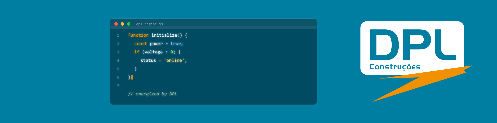
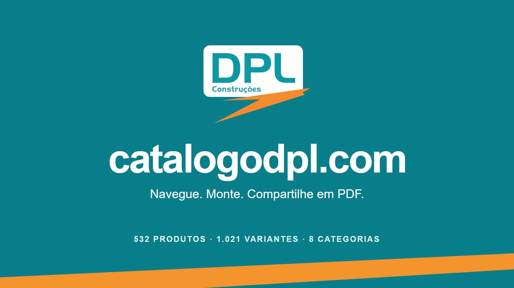

  

## Sou Marco Simões

Desenvolvo sistemas para a operação da DPL, ligada à EQTL no setor de energia elétrica. No Catálogo DPL, trabalhei no caminho entre a escolha do material em campo e o pedido que chega à compra: identificar o item, acertar a variante, informar a quantidade e registrar a urgência.

  <kbd>JavaScript</kbd> &nbsp; <kbd>TypeScript</kbd> &nbsp; <kbd>HTML & CSS</kbd> &nbsp; <kbd>Automação</kbd>

### Catálogo DPL · do material de campo ao pedido em PDF

Pedir um capacete exige mais do que escrever “capacete”: a cor e a quantidade precisam acompanhar a solicitação. Para ferramentas, EPIs e materiais de rede elétrica, o catálogo reúne essas escolhas antes do fechamento do pedido.

**O vídeo mostra o percurso:** buscar um material → escolher a variante → montar o carrinho → classificar a compra → gerar o PDF.

**▶ Clique na imagem para abrir a demonstração em vídeo.**

*Demonstração do lançamento, em outubro de 2026.*

| Na operação | No sistema |
| --- | --- |
| Localizar um EPI ou material de rede | Busca por nome, código DPL ou C.A., além das categorias |
| Especificar o que deve ser comprado | Variantes, tamanhos e quantidades no carrinho |
| Indicar a necessidade da compra | Programada, Mobilização, Urgente ou Emergente |
| Registrar o pedido fechado | Histórico e PDF com os itens e as quantidades |

Também desenvolvi a gestão de produtos e preços. No fechamento, o servidor calcula a estimativa e o pedido guarda os preços daquele momento, preservando o registro quando o catálogo muda.

**Implementação:** HTML, CSS e JavaScript na interface; Node.js nas funções da Vercel; PostgreSQL e Supabase para dados e autenticação.

Esta é uma apresentação de portfólio. O código-fonte permanece privado e esta página não oferece link de acesso ao sistema.

